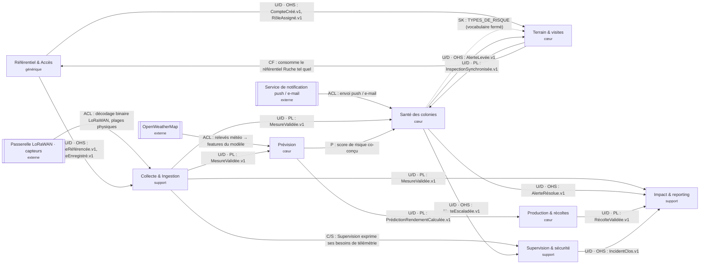

# Context map QueenBee · groupe Dev-1



## Relations (détail)

| # | Amont (U) | Aval (D) | Relation | Échange | Justification |
|---|---|---|---|---|---|
| 1 | Passerelle LoRaWAN (externe) | Collecte & Ingestion | **ACL** | Trames binaires → `Mesure` | Le format radio compact et la numérotation des capteurs n'ont rien à voir avec le modèle interne : une couche anticorruption traduit et filtre (plages physiques). |
| 2 | OpenWeatherMap (externe) | Prévision | **ACL** | Relevés météo → features | API tierce instable et hors de notre contrôle ; on isole le modèle de ses formats. |
| 3 | Collecte & Ingestion | Santé · Prévision · Impact | **U/D · PL : MesureValidée.v1** | Événement « Mesure validée » | Trois consommateurs, un contrat versionné : published language. Contrat détaillé côté Data. |
| 4 | Référentiel & Accès | Collecte · Terrain | **U/D · OHS** | `RucheRéférencée.v1`, `CompteCréé.v1` | Le référentiel publie une API/des événements stables pour tous ; il n'a pas à connaître ses consommateurs. |
| 5 | Prévision | Santé des colonies | **P (partnership)** | Score de risque, `RisqueDétecté` | Les deux équipes livrent ensemble la détection : le seuil et la confiance se règlent à deux. |
| 6 | Santé ⇢ Terrain | Terrain & visites | **SK (shared kernel)** | `TYPES_DE_RISQUE` | Petit vocabulaire fermé réellement partagé (types de risque) ; accepté car très stable et minuscule. |
| 7 | Santé des colonies | Terrain & visites | **U/D · OHS** | `AlerteLevée.v1` | L'alerte déclenche la visite ; le terrain ne renégocie pas le format. |
| 8 | Santé des colonies | Supervision & sécurité | **U/D · OHS** | `AlerteEscaladée.v1` | L'escalade à 48 h est un signal d'exploitation que la supervision consomme (et journalise). |
| 9 | Terrain & visites | Santé des colonies | **U/D · PL** | `InspectionSynchronisée.v1` | Une inspection synchronisée peut résoudre l'alerte et nourrir le score. |
| 10 | Terrain & visites | Référentiel & Accès | **CF (conformist)** | `Ruche` | Le terrain n'a aucune influence sur l'identifiant de ruche : il prend le modèle amont tel quel. |
| 11 | Prévision | Production & récoltes | **U/D · PL** | `PrédictionRendementCalculée.v1` | La production compare la récolte déclarée à la prédiction publiée et versionnée. |
| 12 | Production & récoltes | Impact & reporting | **U/D · PL** | `RécolteValidée.v1` | Le reporting consolide le rendement validé, jamais la déclaration brute. |
| 13 | Collecte & Ingestion | Supervision & sécurité | **C/S (customer/supplier)** | Télémétrie de passerelle (heartbeat, pertes radio) | La supervision exprime ses besoins (fréquence, champs d'intégrité) ; la collecte planifie leur mise à disposition. |
| 14 | Supervision & sécurité | Impact & reporting | **U/D · OHS** | `IncidentClos.v1` | La disponibilité par site entre dans les indicateurs bailleurs. |
| 15 | Santé des colonies | Service de notification (externe) | **ACL** | `AlerteLevée` → push / e-mail | Deux canaux, deux formats, un seul point de traduction ; le domaine reste ignorant du transport. |

## Systèmes externes et anticorruption

| Système externe | Contexte protégé | ACL nécessaire ? | Pourquoi |
|---|---|---|---|
| Capteurs + passerelle LoRaWAN | Collecte & Ingestion | **oui** | Encodage binaire, identifiants matériels, horodatage approximatif |
| OpenWeatherMap | Prévision | **oui** | API tierce, quota, unités et fuseaux différents |
| Service de notification (push / e-mail) | Santé des colonies | **oui** | Deux protocoles distincts ; aucune règle métier ne doit fuir dans l'adaptateur |
| Service de génération PDF (bailleurs) | Impact & reporting | **oui** | Moteur de rendu interchangeable |

> Vérifier le rendu : VS Code (aperçu Markdown), GitHub ou GitLab affichent nativement les blocs ```mermaid```.
