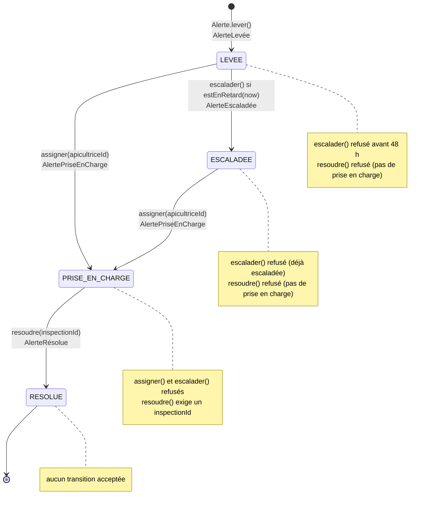
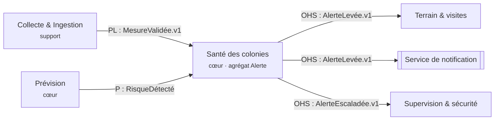

# Spécialité Dev · l'agrégat `Alerte`

Contexte propriétaire : **Santé des colonies** (cœur) · Cas d'utilisation : **UC-A02** (détection
de risque, alerte envoyée) et **UC-A01** (inspection qui permet la résolution).

## 1. Diagramme d'états

Une transition = **un changement d'état + un événement**, via `alerte._passer(etat, evenement)`.
Aucun `switch` sur le statut : le comportement vit dans les objets état (`Levee`, `PriseEnCharge`,
`Escaladee`, `Resolue`) — pattern **State**.

## 2. Invariants de l'agrégat

| # | Invariant | Où il est garanti | Test |
|---|---|---|---|
| I1 | `type` appartient à `TYPES_DE_RISQUE` (`ESSAIMAGE`, `AFFAIBLISSEMENT`, `STRESS_THERMIQUE`, `MORTALITE`) | `Alerte.lever()` — fabrique unique | 2 |
| I2 | `confiance` est un nombre dans `[0 ; 1]` | `Alerte.lever()` | 3 |
| I3 | La résolution exige une prise en charge préalable **et** un `inspectionId` | `Levee.resoudre()` / `PriseEnCharge.resoudre()` | 5, 6 |
| I4 | L'escalade est possible uniquement après 48 h sans prise en charge | `Alerte.estEnRetard()` + `Levee.escalader()` | 7, 8 |
| I5 | Une alerte RÉSOLUE n'accepte plus aucune transition | `Resolue.assigner/escalader/resoudre` | 9 |
| I6 | Une transition produit exactement un événement | `_passer()` | 1, 4, 6, 11 |
| I7 | L'agrégat ne modifie que lui-même ; pour agir ailleurs → événement + politique | aucun import dans `domain/` | `lint:archi` |

## 3. Événements publiés

| Événement | Déclencheur | Porte | Consommé par |
|---|---|---|---|
| `AlerteLevée` | `lever()` (politique P8 du mur) | `alerteId`, `hiveId`, `siteId`, `risque`, `confiance`, `at` | Terrain & visites (planifier une visite), Service de notification (push) |
| `AlertePriseEnCharge` | `assigner()` depuis LEVÉE ou ESCALADÉE | `alerteId`, `apicultriceId`, `at` | Terrain & visites, Supervision (fin du risque d'escalade) |
| `AlerteEscaladée` | `escalader()` après 48 h (politique P9) | `alerteId`, `at` | Supervision & sécurité, notification du coordinateur, Impact & reporting |
| `AlerteRésolue` | `resoudre(inspectionId)` | `alerteId`, `inspectionId`, `at` | Impact & reporting, ColonieSuivie (mise à jour du score) |

Le payload de chaque événement est complété par `_passer()` avec `alerteId` et `hiveId`.

## 4. Place de l'agrégat sur la context map

- **Qui publie `AlerteLevée` ?** Le contexte **Santé des colonies**, à partir de l'agrégat `Alerte`
  et de la politique P8 (« quand un risque est détecté, alors lever une alerte »). L'amont du
  risque est le contexte **Prévision** (événement `RisqueDétecté`, partenariat).
- **Qui consomme `AlerteEscaladée` ?** **Supervision et sécurité** (incident d'exploitation à
  journaliser) et le **service de notification** (coordinateur). **Impact & reporting** consomme
  `AlerteRésolue` pour les indicateurs « colonies sauvées ».

## 5. Décisions de conception

| Décision | Justification |
|---|---|
| Fabrique statique `Alerte.lever()` plutôt qu'un constructeur public | Seul moyen de créer une alerte valide : les invariants I1 et I2 ne peuvent pas être contournés |
| Pattern **State** (objets `Levee`, `PriseEnCharge`, `Escaladee`, `Resolue`) au lieu d'un `switch` | Ajouter un état (ex. `ANNULÉE`) = un objet de plus, sans rouvrir les transitions existantes ; test 12 garanti |
| `estEnRetard(now)` sur l'agrégat, **horloge injectée** | Aucune dépendance à `Date.now()` : les tests avancent le temps |
| Escalade = transition d'état (`ESCALADÉE`), pas un simple compteur | Le cycle de vie est observable (`alerte.statut`), et l'escalade se résout ensuite normalement |
| Événements collectés dans l'agrégat puis publiés par le service | L'agrégat reste pur (aucun couplage au bus) ; `AlerteService` orchestre charger → agir → sauvegarder → publier |

## 6. Extension prévue (pour aller plus loin)

- État `ANNULÉE` (fausse alerte signalée par le coordinateur) : `Levee.annuler()`, `Escaladee.annuler()`,
  événement `AlerteAnnulée`, invariants « une alerte annulée ne se réactive pas ».
- Observateur qui notifie le coordinateur du site en cas d'escalade (pattern **Observer** sur `EventBus`).
- Politique d'escalade à 48 h : voir point chaud **#4** et l'ADR-0001 de la séance 6.
